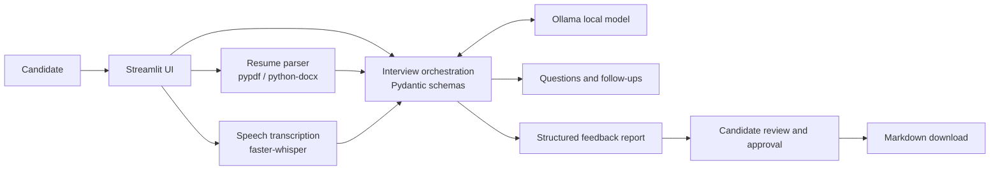

# VoiceHire

VoiceHire is a local-first AI mock interview coach. Add a resume and target role, practice by typing or speaking, get role-aware follow-ups, and review a structured feedback report before exporting it.

## What works in this first version

- Resume text extraction from PDF, DOCX, or TXT, with an editable preview
- Five role-tailored interview questions generated by a local Ollama model, with optional spoken playback
- Typed answers or microphone recording with local faster-whisper transcription
- Follow-up questions when an answer needs more detail
- Structured answer feedback and a complete report scored for relevance, clarity, and evidence
- Report editing and explicit approval before Markdown export
- Streamlit dashboard with preparation, interview, and feedback workspaces

The feedback is practice guidance, not an objective measure of ability or a hiring decision. VoiceHire does not upload your resume or transcript to a hosted AI service. Models and Python packages must be downloaded once during setup; inference runs on your computer.

## Requirements

- Windows 10/11, macOS, or Linux
- Python 3.11 recommended
- [Ollama](https://ollama.com/download) installed and running
- About 4 GB of free disk for the default language model, plus room for the speech model and Python packages
- A microphone for voice answers; typed answers also work
- An installed operating-system voice for spoken questions (Windows SAPI, macOS say, or Linux speech engine)

## Run on Windows with VS Code

Open this `voiciai_interview` folder in VS Code. In the integrated PowerShell terminal:

```powershell
py -3.11 -m venv .venv
.\.venv\Scripts\Activate.ps1
python -m pip install --upgrade pip
pip install -r requirements.txt
ollama pull qwen3.5:4b
streamlit run app.py
```

If PowerShell blocks environment activation, run `Set-ExecutionPolicy -Scope Process Bypass` in that terminal and activate again. Open the local address Streamlit prints, usually `http://localhost:8501`.

On macOS/Linux, create and activate `.venv` with the platform's `python3 -m venv .venv` and `source .venv/bin/activate`, then install requirements, pull the model, and run the same Streamlit command.

### Model and environment options

The default model is `qwen3.5:4b`. If it is too slow or memory hungry, try `qwen3.5:2b`:

```powershell
ollama pull qwen3.5:2b
$env:OLLAMA_MODEL = "qwen3.5:2b"
streamlit run app.py
```

VoiceHire uses Ollama at `http://localhost:11434` by default. To change the endpoint for your local Ollama setup, set `OLLAMA_HOST`. No API keys are required.

## App workflow

1. **Prepare:** Upload a text-based resume or paste resume text. Add the target job title and, optionally, its description.
2. **Interview:** Generate five questions, listen to them using your computer's installed speech voice, then answer using your microphone or the text box. Voice transcription is editable before submission. Ollama can ask a focused follow-up when an answer needs more evidence.
3. **Feedback:** Generate the report, review its scores and notes, edit the Markdown, check the approval box, and download it.

The first voice transcription downloads the `base.en` speech model. Scanned image-only PDFs are not OCR'd in this version; paste their text or use a text-based PDF.

## Architecture



See [the architecture notes](docs/architecture.md) and [the user flow](docs/flow.md) for component boundaries and data flow.

## Project layout

```text
app.py                      Streamlit dashboard and session flow
voicehire/interviewer.py    Ollama prompts, question generation, evaluations, report
voicehire/schemas.py        Pydantic data contracts and report rendering
voicehire/resume_parser.py  PDF, DOCX, and TXT text extraction
voicehire/transcription.py  Lazy-loaded local faster-whisper model
voicehire/speech_output.py  Local system text-to-speech for questions
docs/                       Architecture and end-to-end flow
```

## Troubleshooting

- **Ollama not ready:** Open the Ollama app, then run `ollama list` and confirm the configured model is present.
- **Model not found:** Run `ollama pull qwen3.5:4b` or set `OLLAMA_MODEL` to a model already installed locally.
- **Microphone unavailable:** Open the app on `localhost` and allow microphone permission in the browser. Typed responses remain available.
- **Slow first run:** Ollama and faster-whisper each download models once; later use is local.
- **Weak PDF extraction:** Scanned PDFs need OCR, which is not part of this first version. Paste the resume text into the editor.

## Privacy and data

Session content stays in Streamlit session state in memory and is not written to a database. The only export is the Markdown report after explicit approval. The Ollama server is configured to use the local endpoint; keep it bound to your machine if you want to preserve the local-only setup.

## License

MIT. See [LICENSE](LICENSE).
