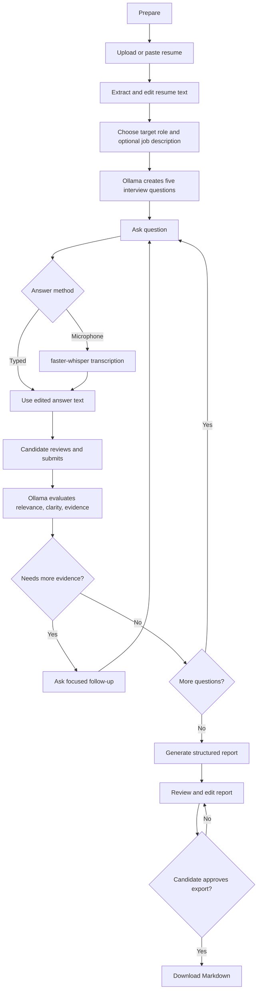

# Interview flow

## Report fields

- Overall summary and role context
- Relevance, clarity, and evidence ratings from 1 to 5
- Specific strengths and improvement suggestions
- Notes tied to each submitted answer

The report explicitly describes the scores as practice guidance. It is intended to help a candidate reflect on their answers, not rank or screen job applicants.
